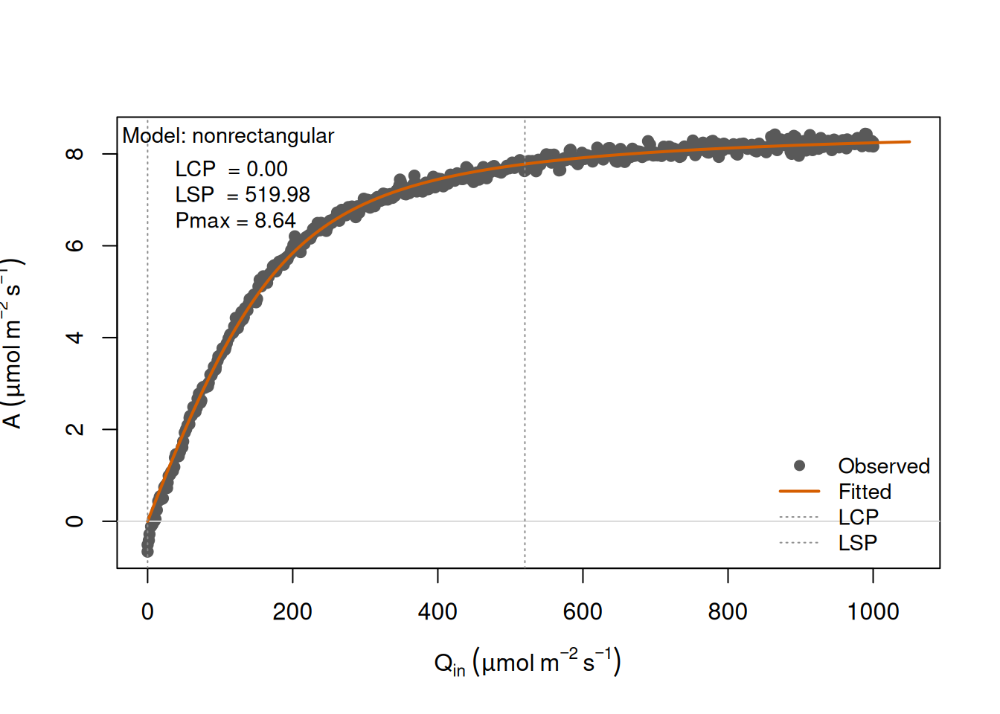

fitAQ – an R package for light response curve fit
================

<!-- README.md is generated from README.Rmd. Please edit that file -->

# fitAQ

<!-- badges: start -->
<!-- badges: end -->

The **fitAQ** package fits four light response models using differential
evolution (`DEoptim`). Models: rectangular hyperbola, non‑rectangular
hyperbola, exponential, modified rectangular hyperbola.

Key outputs: LCP, LSP, Pmax, AQY, Rd.

## Installation

``` r
# install.packages("remotes")
remotes::install_github("zhujiedong/fitAQ")
```

## Example with `dat-aq-wait30.csv`

``` r
library(fitAQ)

# Path to example data (LI-6800 format: Qin / A columns)
df <- read.csv(system.file("extdata", "dat-aq-wait30.csv", package = "fitAQ"))

head(df[c("Qin", "A")])
#>        Qin        A
#> 1 1000.120 8.162426
#> 2  999.877 8.255545
#> 3  998.750 8.216066
#> 4  997.921 8.282314
#> 5  996.231 8.213521
#> 6  994.585 8.170398
```

Fit the exponential model:

``` r
set.seed(42)
fit_exp <- fit_light_response(df, model = "exponential")
print(fit_exp)
#> 
#> Call:
#> fit_light_response(data = df, model = "exponential")
#> 
#> Model: exponential 
#> Optimized parameters:
#>    Am     b    Ic 
#> 8.152 0.006 8.921 
#> 
#> Residual sum of squares: 7.816 
#> Apparent quantum yield (AQY): 0.102 
#> Dark respiration (Rd): 0.58 
#> Light compensation point (LCP): 8.921 
#> Light saturation point (LSP, 90 % Pmax): 365.378 
#> Maximum net photosynthesis (Pmax): 8.152
```

Extract parameters:

``` r
light_points(fit_exp)
#>        LCP      LSP     Pmax       AQY        Rd
#> 1 8.920682 365.3782 8.151923 0.1018542 0.5800604
```

Compare all four models:

``` r
set.seed(42)
models <- c("rectangular", "nonrectangular", "exponential", "modified")
res_list <- lapply(models, function(m) {
  fit_light_response(df, model = m)
})
names(res_list) <- models

sapply(res_list, function(x) round(x$value, 2))
#>    rectangular nonrectangular    exponential       modified 
#>          46.42           7.49           7.82          20.54
```

## Plotting

`plot()` draws the observed data, the fitted curve, and the derived
light compensation point (LCP) and light saturation point (LSP) using
base graphics:

``` r
plot(res_list[["nonrectangular"]])
```



Predictions along the curve can be extracted with `predict_from_fit()`:

``` r
head(predict_from_fit(fit_exp))
#>        Qin      A_pred
#> 1  0.00000 -0.48354745
#> 2 10.60733  0.08833434
#> 3 21.21467  0.62234341
#> 4 31.82200  1.12098787
#> 5 42.42933  1.58660973
#> 6 53.03667  2.02139590
```

## Example with `lrc.csv`

`lrc.csv` is in LI-6400 format (`PARi` / `Photo` columns), so we set
`type = "LI-6400"`:

``` r
df2 <- read.csv(system.file("extdata", "lrc.csv", package = "fitAQ"))

fit_rect <- fit_light_response(df2, type = "LI-6400", model = "rectangular")
light_points(fit_rect)
#>   LCP      LSP     Pmax       AQY        Rd
#> 1   0 2081.877 16.60886 0.0595621 0.1184999
```

## Model formulas

- Rectangular: $A = \frac{\alpha Q A_m}{\alpha Q + A_m} - R_d$
- Non‑rectangular:
  $A = \frac{1}{2\theta}\left(\alpha Q + A_m - \sqrt{(\alpha Q + A_m)^2 - 4\alpha\theta A_m Q}\right) - R_d$
- Exponential: $A = A_m \left[1 - \exp(-b(Q - I_c))\right]$
- Modified: $A = \alpha \frac{1-\beta Q}{1+\gamma Q} Q - R_d$

## License

MIT © Jiedong Zhu

## References

Baly, EC. 1935. 《The kinetics of photosynthesis》. Proceedings of the
Royal Society of London Series B (Biological Sciences), 期 117: 218–39.

Thornley, J H M. 1976. 《Mathematical models in plant physiology》.
London: Academic Press. Prado, C. H., 和 J. A. P. V. De Moraes. 1997.

《Photosynthetic capacity and specific leaf mass in twenty woody species
of Cerrado vegetation under field conditions》. Photosynthetica 33 (1):

103–12. ZiPiao, YE. 2010. 《A review on modeling of responses of
photosynthesis to light and CO2CO2​》. Chinese Journal of Plant Ecology,
期 06.
